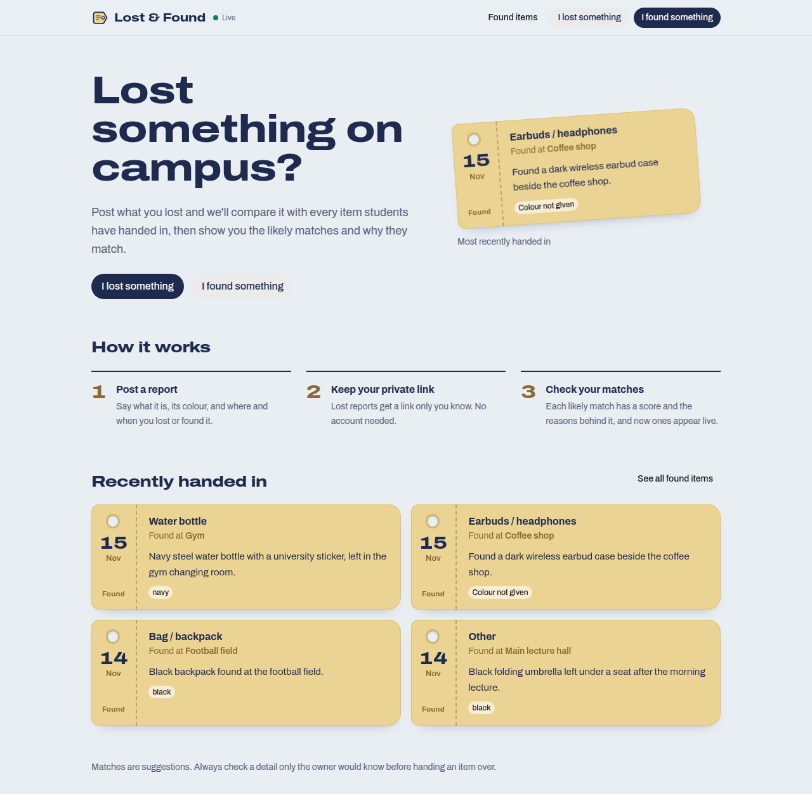
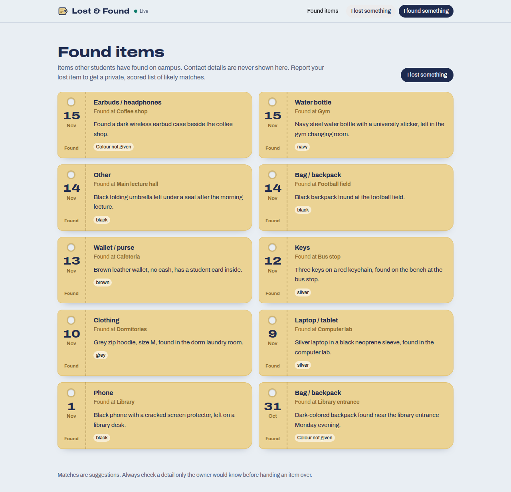
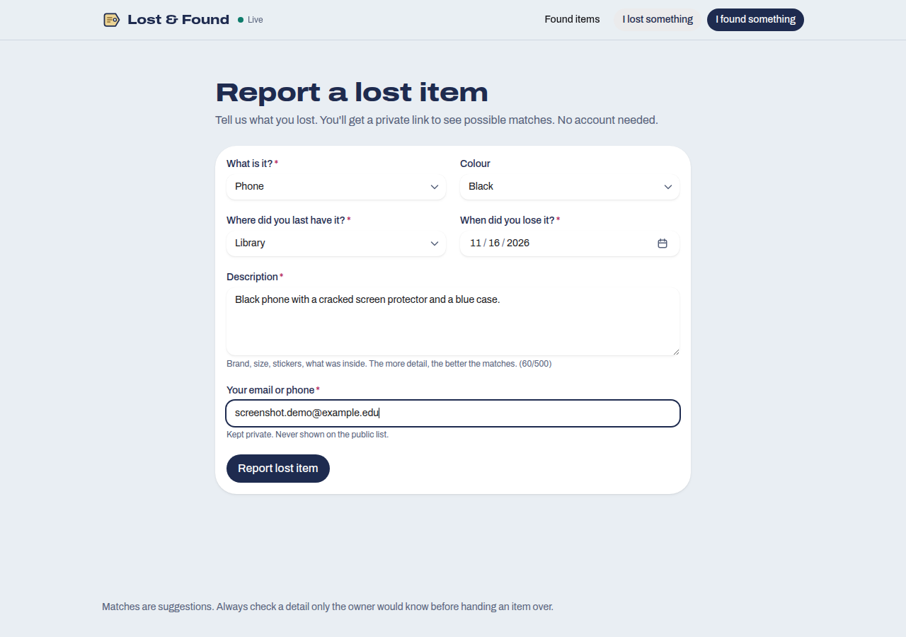
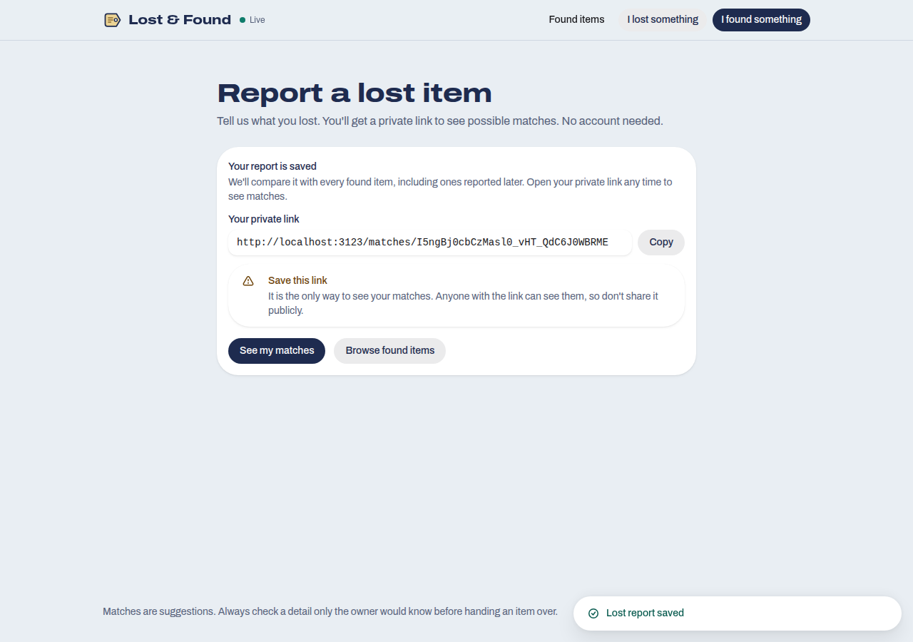
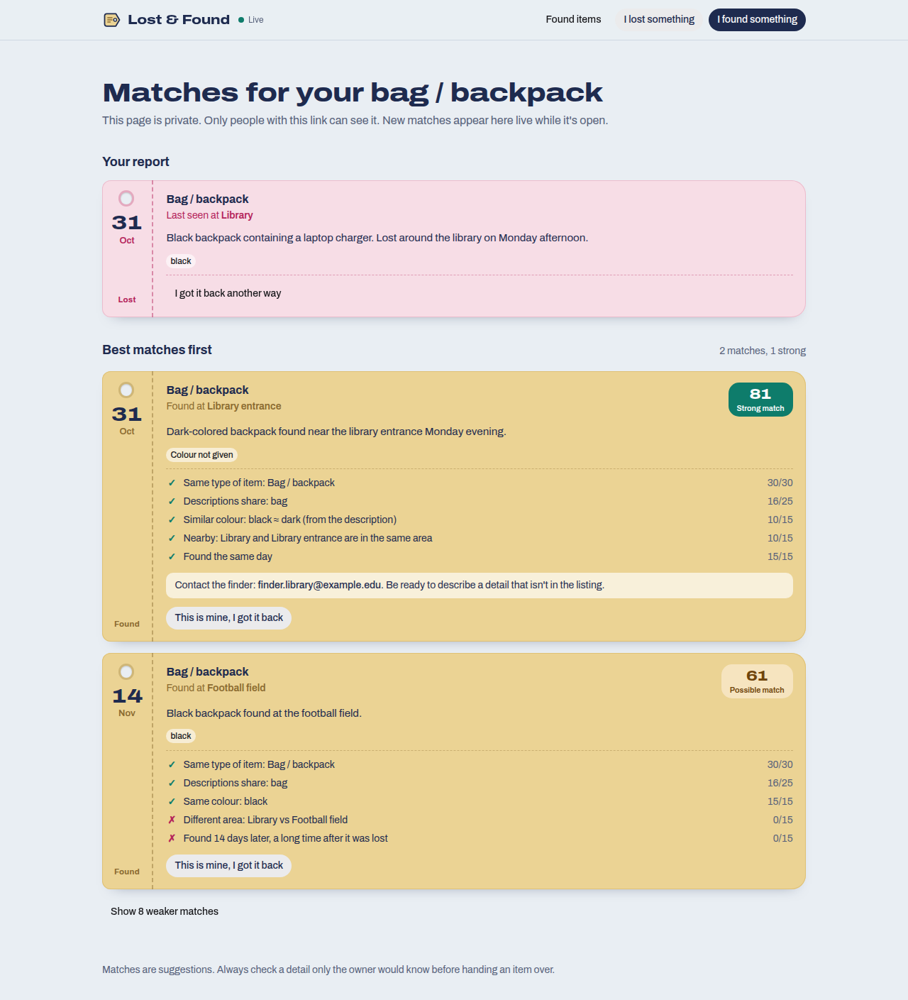
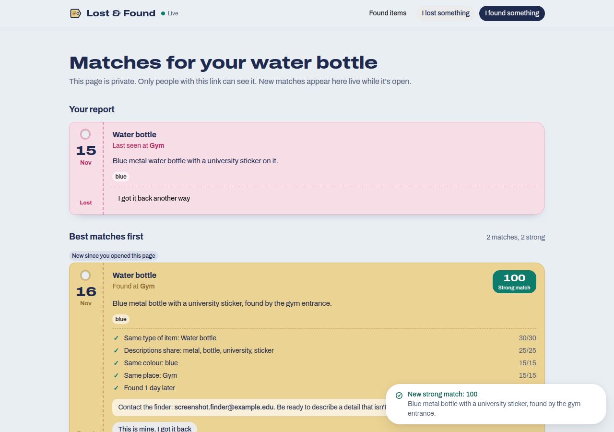
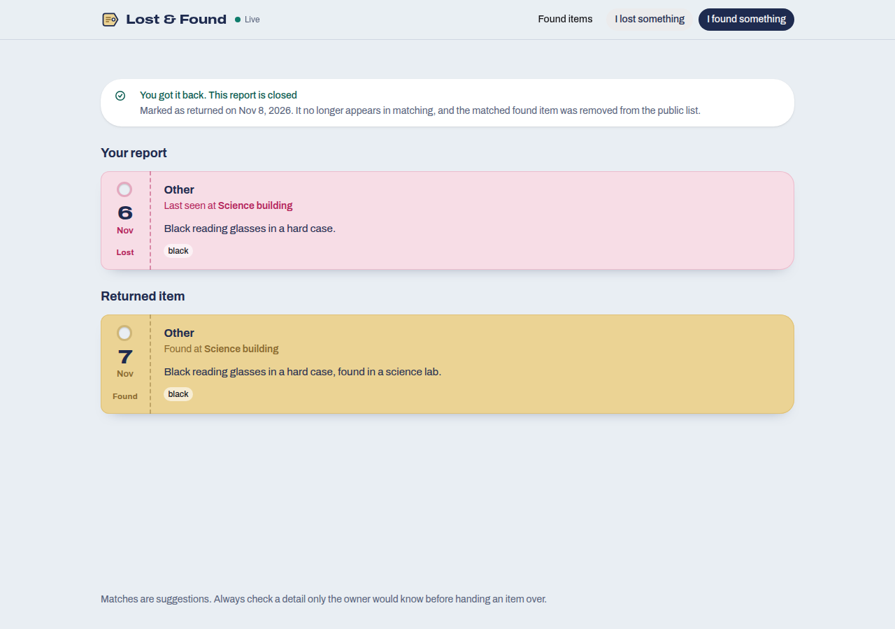

# Lost & Found Matcher

## What it is

A small web app for a university lost-and-found. Students post two kinds of reports:

- **Lost:** "I lost my black backpack near the library."
- **Found:** "Found a dark backpack by the library entrance."

The app compares every lost report with every found report, gives each pair a **score from 0 to 100**,
and explains why they match. The person who lost the item sees their matches on a **private link**.
No account is needed.



Built for a software engineering assessment. The phase-by-phase build plan is in [PLAN.md](PLAN.md).

---

## How to run

**You need:** [Node.js](https://nodejs.org) (tested on version 24) and [Docker](https://www.docker.com) running.

**Step 1: copy the settings file.** It holds the database address.
```bash
cp .env.example .env
```

**Step 2: start the database.** This runs Postgres in Docker on port **5433**, so it won't clash with a Postgres already on your machine.
```bash
docker compose up -d
```

**Step 3: install the packages.** This also generates the database client.
```bash
npm install
```

**Step 4: create the tables and load demo data.** The demo data includes the examples from the brief.
```bash
npx prisma migrate dev
npx prisma db seed
```

**Step 5: start the app**, then open **http://localhost:3000**.
```bash
npm run dev
```

**Other commands**

| Command | What it does |
|---|---|
| `npm test` | Runs the 41 unit tests (matching, validation, live updates) |
| `npm run db:seed` | Resets the demo data. Reports you created yourself are kept |
| `npm run db:studio` | Opens a browser view of the database |
| `docker compose down` | Stops the database. Your data is kept |

---

## How to use it

1. **Lost something?** Click **I lost something** and fill in what it is, its colour, where and when,
   and a description. You get a **private link**. Save it, because it is the only way back to your matches.
2. **Found something?** Click **I found something** and fill in the same details. The item appears on
   the public **Found items** list, without any contact details.
3. **See your matches.** Open your private link. Each likely match shows a score, a label
   (**Strong** or **Possible**) and the reasons, such as "same type of item" or "found 1 day later".
   New matches appear while the page is open, without reloading.
4. **Got it back?** Click **"This is mine, I got it back"**. Your report and the matched found item are
   closed and leave the public list. Reports nobody closes expire after 60 days.

### Try it with the demo data

After step 4 of "How to run", each demo lost report has a fixed private link:

| Lost report | Private matches link | What you'll see |
|---|---|---|
| Black backpack with a laptop charger (brief) | [/matches/demo-black-backpack-0001](http://localhost:3000/matches/demo-black-backpack-0001) | Strong: backpack at the library entrance. Possible: backpack at the football field two weeks later |
| Black AirPods case (brief) | [/matches/demo-airpods-case-0002](http://localhost:3000/matches/demo-airpods-case-0002) | Strong: "dark wireless earbud case" at the coffee shop |
| Silver keys on a red keychain | [/matches/demo-silver-keys-0003](http://localhost:3000/matches/demo-silver-keys-0003) | Strong: keys at the bus stop (same area as the parking lot) |
| Blue water bottle | [/matches/demo-blue-bottle-0004](http://localhost:3000/matches/demo-blue-bottle-0004) | Strong: navy bottle in the gym (blue ≈ navy) |
| Student ID card | [/matches/demo-student-id-0005](http://localhost:3000/matches/demo-student-id-0005) | Possible: a wallet "with a student card inside" |
| Reading glasses | [/matches/demo-returned-glasses-0006](http://localhost:3000/matches/demo-returned-glasses-0006) | Already closed with "I got it back" |

Clicking **"This is mine, I got it back"** really closes the reports. Run `npm run db:seed` to reset.

### Try it with your own reports

1. Report a **lost** item: Phone, Black, Library, yesterday, "Black iPhone with a blue case". Open the private link in a tab.
2. In another tab, report a **found** item: Phone, colour not sure, Library entrance, today, "Dark phone with a blue case".
3. Your private link tab shows a new **Strong** match within a second, without reloading.

---

## Approach

The app does not decide ownership. It **suggests** likely matches and explains why, and a person
makes the final call. I kept the build small and put the effort into three things:

1. **Clean input:** category, colour, location and date are picked from lists, and the description is free text.
2. **Explainable matching:** every score comes with reasons a person can check.
3. **Privacy:** found items are public with limited details, while matches, scores and contact details are private.

## How matching works

Code: [`src/lib/matching/`](src/lib/matching/). These are pure functions with no database, covered by unit tests.

Each lost/found pair gets a score from 0 to 100, made of five signals. **Every signal also produces a
reason**, shown to the user, so a person can check why two reports matched.

| Signal | Max | Full points | Partial points | Zero |
|---|---|---|---|---|
| Category | 30 | Same type | Related types (wallet ↔ ID card) = 15; one is "Other" **and** descriptions overlap = 10 | Unrelated, or "Other" with nothing in common |
| Description | 25 | TF-IDF cosine ≥ 0.8 | Scaled below that | No key words shared |
| Colour | 15 | Same colour | Similar (black ≈ navy ≈ "dark") = 10; unknown = 5 | Different |
| Location | 15 | Same place | Same campus zone (library ≈ library entrance) = 10; unknown = 5 | Different zone |
| Time | 15 | Found 0–3 days after the loss | Fades linearly from day 3 to day 14 | 14+ days |

**Description similarity (TF-IDF).** Each description is turned into keywords:
1. Remove filler words. Also remove colour, time and place words, because those already have their own signals and would otherwise be counted twice.
2. Remove plurals (backpacks → backpack).
3. Map synonyms to one word (AirPods / earphones → *earbud*, backpack / rucksack → *bag*).
4. Weight words by how rare they are across all open reports. Sharing "charger" counts more than sharing "bag".

**Missing information is neutral, not negative.** If the colour field is empty, the matcher looks for a
colour word in the description ("dark-colored backpack" → *dark*). If there is none, both reports get
a neutral 5 points instead of 0.

**Hard rules**
- Found more than 1 day **before** the loss → not a match. One day is allowed for date mistakes.
- **Unrelated categories are capped at 30**, so a black phone never matches a black bag just because colour, place and time agree.
- Closed and expired reports are never matched.

**Labels:** ≥ 70 **Strong**, 45–69 **Possible**, below 45 hidden.

**The brief's examples, as scored by the app** (also unit tests):

| Lost: *black backpack with a laptop charger, library, Monday* vs. found... | Score |
|---|---|
| Dark-colored backpack near the library entrance, Monday evening | **79, Strong** |
| Black backpack at the football field, two weeks later | **59, Possible**, flagged "different area" and "14 days later" |
| Black backpack with a laptop charger inside, library, next day | **100, Strong** |
| Black phone in the library, same day | **30, hidden** (different type of item) |

| Lost: *black AirPods case near the cafeteria* vs. found... | Score |
|---|---|
| Dark wireless earbud case beside the coffee shop, next day | **87, Strong** |

These are scored as single pairs. In the running app, the description score shifts by a point or two,
because word rarity is computed across all open reports.

The football-field case is intentionally **Possible**, not hidden: it's the same kind of bag, but the
place and time don't fit, so the app shows it with those doubts spelled out and lets a person decide.

## Report lifecycle (how we know an item was returned)

| Status | Meaning | Visible publicly? |
|---|---|---|
| `OPEN` | Still lost / still waiting for its owner | Found reports: yes |
| `RESOLVED` | Owner clicked **"I got it back"** on their private link | No |
| `EXPIRED` | Open for more than 60 days with no update | No |

- The owner closes the report from their private link. If they pick which found report was theirs,
  that found report is closed too.
- The finder cannot close a report, because they have no private link. In this version the
  owner's confirmation is the source of truth.
- Closed reports are **kept in the database, not deleted**, so they could be used later to measure
  how well matching works.

## Live updates (Server-Sent Events)

Pages update without reloading. The navbar shows **● Live** while connected.

| Stream | Who | Events |
|---|---|---|
| `GET /api/events` | Everyone (opened app-wide in the layout) | `report.created` (new found item), `report.resolved` (item returned) |
| `GET /api/events/:token` | The owner, on their private matches page | the public events plus `match.found` (a new Strong/Possible match) and `lost.resolved` |

- **What updates live:** the found list shows new items at the top with a "New" badge, and returned items disappear. The matches page shows new matches with a toast and switches to the "closed" view if the report is closed from another tab or device.
- **Same numbers as a reload:** a pushed match is scored by the same function the page uses.
- **Never slows down posting:** notifications run after the response is sent (`after()`).
- **Never leaks private data:** the public stream carries only public fields, with no contact details or tokens.
- **Client state:** React Context + `useReducer` ([`src/context/`](src/context/)). It has typed actions and a pure, unit-tested reducer, the same pattern as Redux without the dependency.
- **Limitation:** the event bus is in memory, so it works with **one server process**. Running several instances would need Postgres `LISTEN/NOTIFY` or Redis pub/sub.
- **Limitation:** each open page holds one or two streams. Over plain HTTP/1.1 (local dev), browsers allow only 6 connections per site, so with many tabs open a stream can wait in a queue. HTTP/2, which production hosting normally uses, removes this limit.

## Assumptions

- One university with a fixed list of campus locations.
- Reports are honest. There is no spam or abuse protection.
- A found item cannot be found before it was lost (1-day grace for date mistakes).
- Matches are suggestions and are never automatic handovers. The owner and the finder or lost-and-found office arrange the handover themselves.
- The person who lost the item saves their private link. Without accounts, a lost link cannot be recovered.
- Small data volume, so matches are computed on request instead of stored.

## Technical decisions

| Decision | Reason |
|---|---|
| **Next.js (App Router)** for UI and API | One project, one command to run |
| **PostgreSQL in Docker + Prisma** | Reproducible DB, typed queries, migrations and seed |
| **HeroUI** (formerly NextUI) with reusable wrapper components | Consistent, accessible UI with thin pages |
| **React Context + `useReducer`** (Redux pattern) | Global live state without an extra library; easy to move to Redux Toolkit |
| **Server-Sent Events** for live reports and matches | Updates only go server→client, so SSE is simpler than WebSockets and reconnects on its own |
| **Rule-based scoring + TF-IDF** instead of an LLM API | Free, fast, predictable and explainable |
| **Secret link** instead of accounts | Keeps scores private with no login system. The page is `noindex` and sends no Referer, so the link doesn't leak |
| **Finder contact shown only on Strong matches** | Otherwise anyone could post vague fake lost reports just to collect finders' emails |
| **Matches computed on request**, not stored | Always reflects the latest reports. Fine at university scale (see "What I would build next") |
| **Soft close (status) instead of delete** | Keeps history for auditing and for measuring match quality |
| **zod** validation shared by client and server | One source of truth for input rules |
| **"Claim tag" visual design** | Every report is drawn as a paper claim tag: manila for found, raspberry for lost, with the date on a perforated stub. Lost and found look different at a glance, and the theme comes from the real lost-and-found office. One typeface (Archivo, expanded for headings) and a navy/manila palette, set through HeroUI's theme tokens |

## Not built on purpose

The brief asked for a small app, so I left these out to focus on matching and clear decisions.

| Not built | Why I skipped it | What the app does instead |
|---|---|---|
| **User accounts / login** | Auth adds a lot of code (passwords, sessions, reset flows) and isn't needed to show matching | A **secret private link** per lost report acts as the key |
| **Email / SMS / push notifications** | Needs an email provider, templates and background jobs | **Live updates (SSE)** while the private page is open |
| **AI / LLM scoring** | Costs money, needs an API key, and scores are harder to explain and test | **Rule-based scoring + TF-IDF**: free, predictable, explainable |
| **Human evaluator / staff review** | Needs roles, permissions and an admin UI | The **owner** confirms the return by clicking "I got it back" |
| **Ownership verification** | Needs a claim flow and a reviewer | Public found list shows **limited details**, so false claims are harder |
| **Photo upload / image matching** | Needs file storage and image models | Text, category, colour, place and time only |
| **Finder closing reports** | Finders have no link or account | Only the owner can close |
| **Multi-server realtime** | Needs Redis or Postgres `LISTEN/NOTIFY` | In-memory event bus (single server) |
| **Spam protection / rate limiting** | Not core to the problem | Input validation only |

## What I would build next for a real product

**1. Accounts and notifications**
- Students sign in with their **university account (SSO)**, so no separate passwords are needed.
- Reports belong to the account. "My reports" and "My matches" replace the secret link, so nothing is lost if a link is forgotten.
- **Notifications** by email or push when a new **Strong** match appears, instead of only live updates while the page is open.

**2. Public found list (kept, but improved)**
- Found items stay **public** so anyone can browse them.
- Search and filters by category, place and date.
- Optional photo, blurred or cropped so unique details stay hidden.

**3. Real AI scoring**
- Replace TF-IDF with **text embeddings** stored in Postgres with **pgvector**, so meaning matches,
  not just words ("wireless earbud case" ≈ "AirPods case").
- Optional **LLM check** on the top few candidates, which returns a score plus a short explanation.
- **Image similarity** when photos are added.
- Keep the rule-based signals (time, place, date limits) as guardrails, so AI cannot match a
  found item dated before the loss.

**4. Evaluator (human in the loop)**
- A **lost-and-found staff dashboard**: see strong matches, contact both sides, and confirm handovers.
- **Ownership verification:** the claimant describes a hidden detail (serial number, sticker, contents),
  and staff compare it before handing the item over.
- The staff confirmation marks reports as `RESOLVED`, which is more trustworthy than the owner alone.

**5. Measuring and improving match quality**
- Record which suggested matches were **confirmed or rejected** by staff and owners.
- Use that data to **tune the weights** or train a ranking model, and track precision
  (how many suggested matches were real).

**6. Running at scale**
- Compute matches when a report is posted (background job) instead of on every page view.
- Realtime over Redis or Postgres `LISTEN/NOTIFY` so it works across several servers.
- Spam protection, rate limiting and automatic expiry jobs.

## Known issues

- In development only, the terminal sometimes shows a React Aria warning: "If you do not provide a
  visible label…". Every field has a visible label, and I couldn't reproduce the warning in automated
  browser runs, so its source isn't confirmed yet. It doesn't appear in production builds.

## Screenshots

These were taken from the running app with the seed data.

| | |
|---|---|
| **Home:** the newest found item hangs as a claim tag | **Public found list:** no contact details |
|  |  |
| **Report a lost item** | **Saved:** the private link is the owner's key |
|  |  |
| **Private matches:** score, label and reasons | **Live:** a new found item arrives while the page is open |
|  |  |

**Closed with "I got it back"**



## AI usage

I built this with **Claude Code** (Anthropic's coding agent) as a pair programmer, working phase by
phase from [PLAN.md](PLAN.md) and committing after each phase.

**What I decided**
- The product shape: a public found list, private scores behind a secret link instead of accounts,
  and a way to close a report once the item is returned.
- The stack: Next.js for frontend and API in one app, Postgres in Docker, HeroUI components, a
  Context + reducer store, and Server-Sent Events for live updates.
- Scope: accounts, email notifications and AI scoring went into "Not built on purpose" and
  "What I would build next" rather than the 3-hour build.
- To use simple, explainable text similarity (TF-IDF) instead of an LLM API, after asking how
  well it would work in a real system.

**What Claude did**
- Proposed the matching design and wrote most of the code, tests, seed data and this README.
- Read the installed library docs before using them. This version of Next.js and HeroUI v3 differ
  from older versions, for example Cache Components rules and HeroUI's new component API.
- Tested each phase in a real browser with scripted Chrome sessions, in addition to unit tests.

**What changed after review and testing.** These were caught by tests or by looking at real
output, then fixed:
- Scoring gave too many points for sharing just the word "bag", which is already covered by the
  category. The text weighting was made stricter.
- A lost student ID matched an umbrella filed as "Other" only because place and time fit. "Other"
  now earns category points only when the descriptions overlap.
- An empty date showed "must be within 90 days" because empty was read as a 1970 date.
- "glasses" was stemmed to "glasse".
- A CSS class clashed with HeroUI's own `.tag` class and broke the claim-tag layout.
- HeroUI's date picker reads the clock while rendering, which this Next.js version blocks during
  pre-render. It now loads in the browser only.

